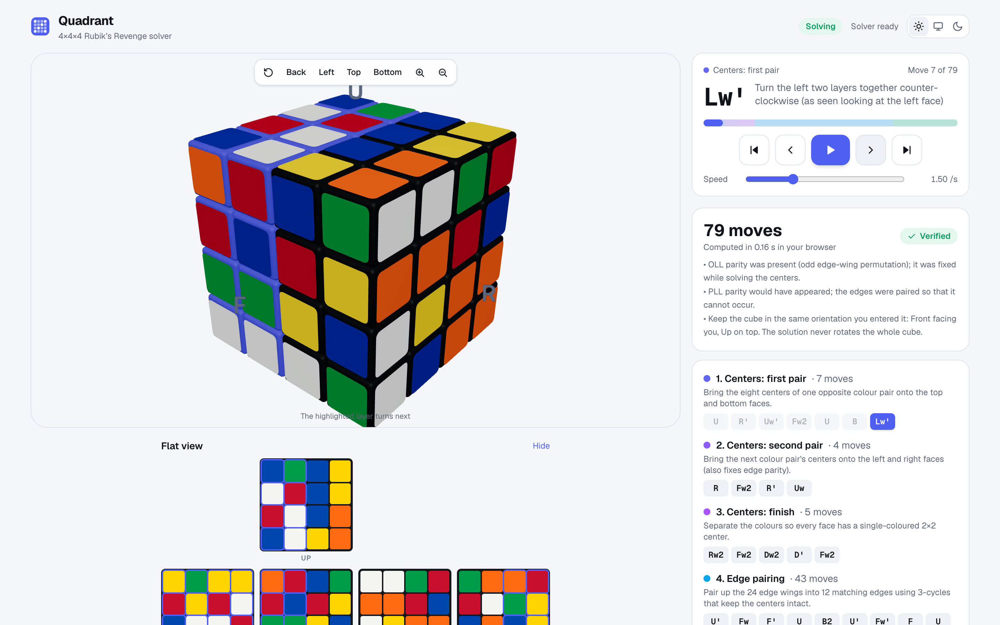
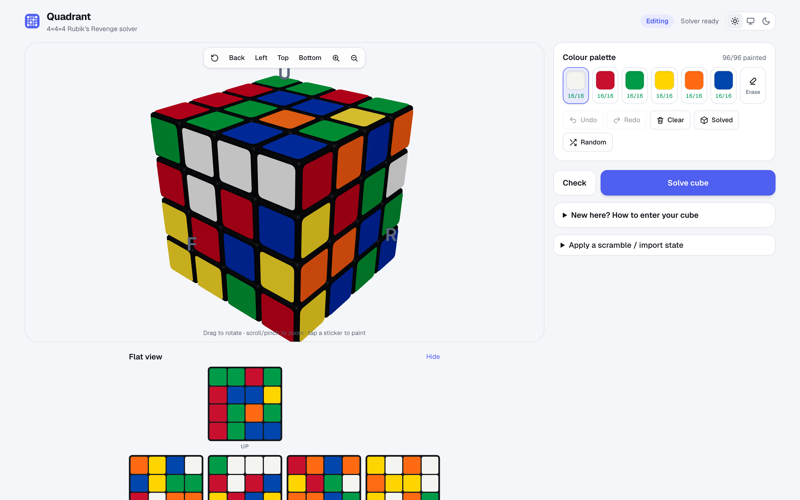
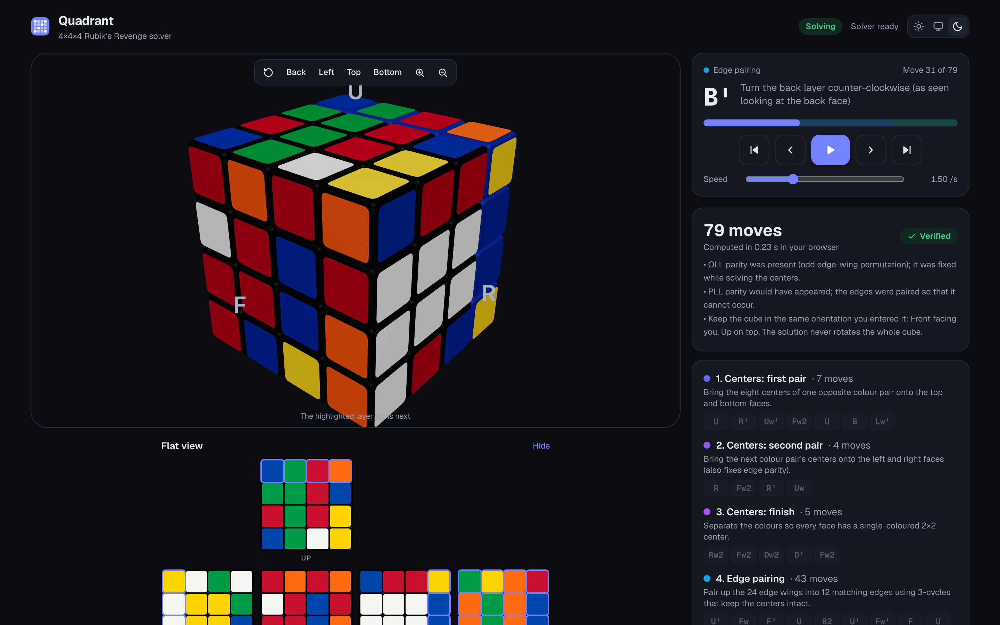
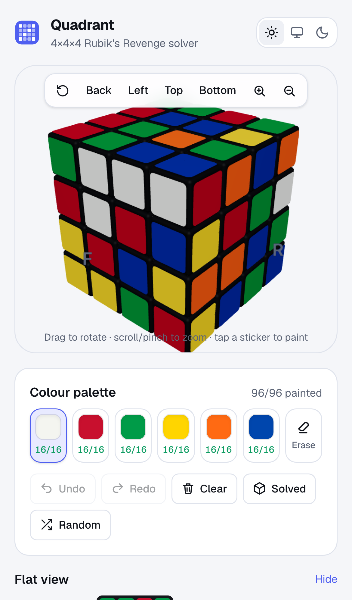

# Quadrant — 4×4×4 Rubik's Revenge Solver

Enter the stickers of a real scrambled 4×4×4 cube, get a **verified** solution and follow it
move by move on an animated 3D cube. Everything — validation, solving and replay checks —
runs in your browser.

**Live app:** _see the deployment link in the repository description_



| Editing | Dark mode | Mobile |
| --- | --- | --- |
|  |  |  |

## Features

* **Interactive 3D cube** (React Three Fiber): drag/touch to orbit, scroll/pinch or buttons to
  zoom, view presets (front, back, left, top, bottom), click stickers to paint.
* **Synchronized 2D net**: keyboard-accessible, faster for entering all 96 stickers.
* **Palette with live counts** (x/16 per colour), eraser, keys `1`–`6`/`0`.
* **Undo / redo / clear / solved / random**, apply a scramble in notation, import/export the
  96-letter state string. Unfinished input is saved locally.
* **Validation with actionable messages**: missing stickers, colour counts, impossible or
  mirrored corners, duplicated/flipped wings, twisted corners — offending stickers are
  outlined in red. Any colour scheme is accepted (it is derived from the corners).
* **Real 4×4×4 solver** (reduction: centers → edge pairing → 3×3×3) with OLL and PLL parity
  handled — see [docs/SOLVER.md](docs/SOLVER.md). ~84 moves on average, ~0.3 s.
* **Solution playback**: animated turns, highlighted turning layer (3D and net), Previous /
  Next / Play / Pause / Restart / End, speed slider, progress bar with stage segments,
  clickable move list, plain-English description of each move, and a **Verified** badge
  (the solution is replayed on the simulator in the worker and again on the page).
* Light, dark and system themes; responsive desktop and mobile layouts.

## Notation

`R` right outer layer clockwise (looking at that face), `R'` counter-clockwise, `R2` half turn,
`Rw` two right layers together. Same for `U F D L B`. Input also accepts SiGN `r` (= `Rw`),
inner slices `2R`, and rotations `x y z`. Solutions use only outer and wide turns, never
cube rotations — hold the cube the way you entered it (Front facing you, Up on top).

## Getting started

Requirements: Node.js 20+ (CI uses 22) and npm.

```bash
npm install
npm run dev          # http://localhost:3000
```

| Script | Purpose |
| --- | --- |
| `npm run build` / `npm start` | production build / serve |
| `npm test` | Vitest unit + integration tests |
| `npm run test:e2e` | Playwright E2E (desktop + mobile; run `npx playwright install chromium` once) |
| `npm run lint` / `npm run typecheck` | ESLint / TypeScript |
| `npm run bench -- 200 12345` | solve 200 random positions + scrambles, verify, print stats |
| `npm run gen:wings` | regenerate the wing 3-cycle library (deterministic) |

No environment variables are required. See [docs/ARCHITECTURE.md](docs/ARCHITECTURE.md#environment-variables)
for the optional test-only variables.

## Documentation

* [Reference analysis](docs/REFERENCE_ANALYSIS.md) — Phase 1 study and library survey
* [Architecture](docs/ARCHITECTURE.md) — modules, data flow, trade-offs
* [Solver](docs/SOLVER.md) — algorithm, parity handling, performance, limitations
* [Testing](docs/TESTING.md) — test inventory and latest results

## Project layout

```
src/lib/cube/        cube model: geometry, moves, pieces, state, validation, random states
src/lib/solver/      centers, edge pairing (+ wingLibrary.json), two-phase 3x3x3, orchestration
src/workers/         Web Worker entry
src/store/           zustand store (persisted)
src/components/      3D canvas, net, panels
tests/unit/          Vitest      tests/e2e/   Playwright
scripts/             wing-library generator, benchmark, screenshot capture
```

## Licence and attribution

MIT — see [LICENSE](LICENSE). The solver, cube model and UI are original code. Algorithms
follow published ideas: the reduction method for big cubes, commutator-based 3-cycles, and
Herbert Kociemba's two-phase algorithm for the 3×3×3 stage (independent implementation).
Built with [Next.js](https://nextjs.org), [React Three Fiber](https://github.com/pmndrs/react-three-fiber),
[drei](https://github.com/pmndrs/drei), [three.js](https://threejs.org), [zustand](https://github.com/pmndrs/zustand)
and [Tailwind CSS](https://tailwindcss.com) (all MIT). Interaction ideas were inspired by the
Grubiks 4×4×4 solver; no code or assets from it are used. Not affiliated with the Rubik's brand.
